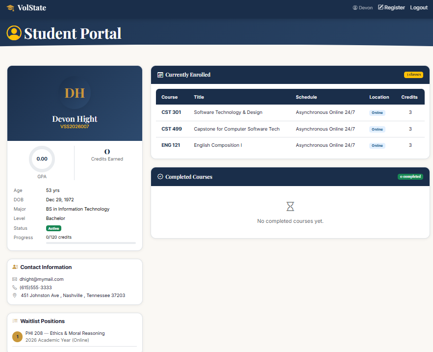
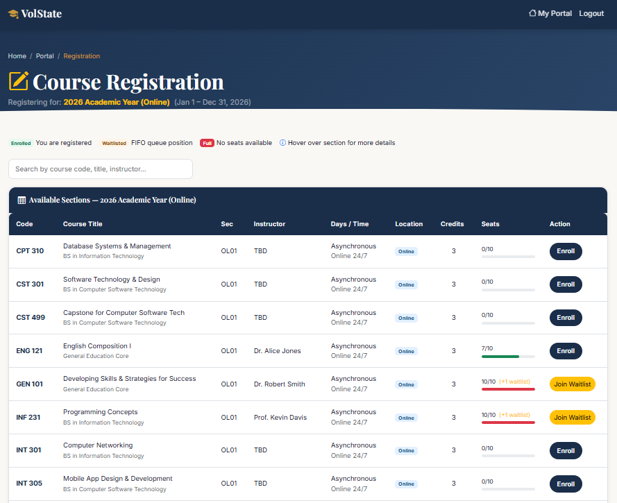
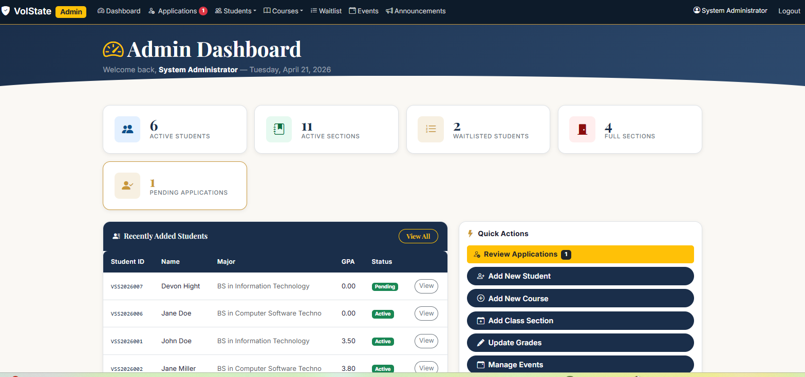
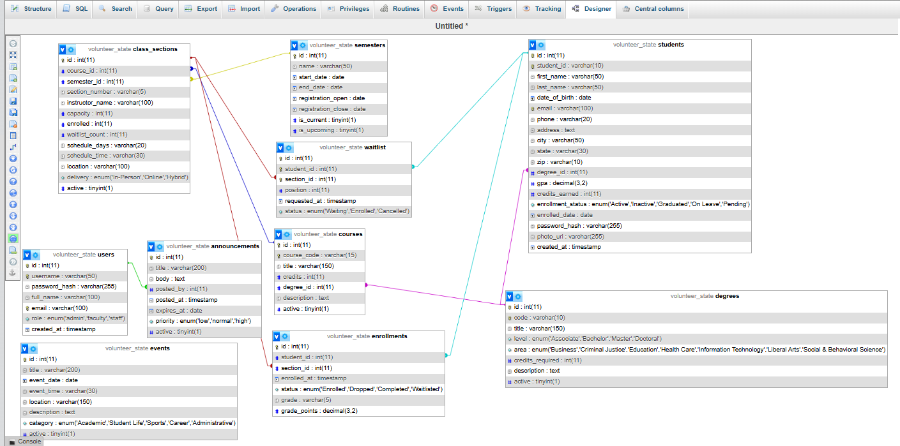

# Volunteer State College — University Management System (UMS)

A full-stack web application and normalized relational database built to streamline student enrollment, course scheduling, automated FIFO waitlist management, and campus communications for Volunteer State College.

> **Engineering Context:** Developed as a senior Computer Science capstone project following **ISO/IEC/IEEE 29148:2018** Software Requirements Specification (SRS) standards, complete with 5 UML system models and a 4-stage QA test plan.

---

## Visual Preview

### Role-Based Login Portal


### Student Registration & FIFO Waitlist


### Admin Dashboard


### Relational Database Schema (ERD)


---

## Core Capabilities & Business Logic
* **Automated FIFO Waitlist Engine:** Enforces strict section seat limits (`capacity` vs. `enrolled`). When a section reaches capacity, incoming registration requests automatically queue in `waitlist` with sequential `position` tracking and transition statuses (`Waiting` → `Enrolled` / `Cancelled`) as seats open.
* **Role-Based Access Control (RBAC):** Dedicated authentication and views for **Administrators**, **Faculty**, **Staff**, and **Students**, backed by bcrypt password hashing (`password_hash()` / `password_verify()`).
* **Academic & Degree Tracking:** Maps courses to specific degree tracks (`BS-IT`, `BS-CST`, `GEN-ED`), enforces credit rules, and tracks student enrollment states (`Enrolled`, `Dropped`, `Completed`, `Waitlisted`) alongside GPA calculations.
* **Campus Operations Hub:** Manages priority-ranked campus announcements with automatic expiration dates and categorized event calendars (`Academic`, `Career`, `Student Life`, `Sports`, `Administrative`).

---

## Tech Stack & Architecture
* **Backend:** PHP 8.2 (PDO / MySQLi, Session Management, Server-Side Validation)
* **Database:** MariaDB 10.4 / MySQL (InnoDB Engine, `utf8mb4`, 10 Normalized Tables)
* **Frontend:** HTML5, CSS3, Vanilla JavaScript
* **Documentation & QA:** ISO/IEC/IEEE 29148:2018 SRS, UML Diagrams (Use Case, Class, Sequence, Activity, State Machine), 4-Stage Test Plan

### Database Schema (`volunteer_state`)
Designed in Third Normal Form (3NF) with strict referential integrity (`FOREIGN KEY` constraints, `ON DELETE SET NULL` rules, and composite unique keys like `unique_waitlist` to prevent duplicate queue entries):
* **Identity & Access:** `users`, `students`
* **Academic Catalog:** `degrees`, `courses`, `semesters`, `class_sections`
* **Transactions & Queues:** `enrollments`, `waitlist`
* **Campus Content:** `announcements`, `events`

---

## Quick-Start Guide (Run Locally in 5 Minutes)

### Prerequisites
* [XAMPP](https://www.apachefriends.org/) (or any local stack running **PHP 8.0+** and **MySQL / MariaDB**)

### Step 1: Clone the Repository
Clone this repository into your web server's root directory as `volunteer_state` (e.g., inside `C:\xampp\htdocs\` on Windows or `/Applications/XAMPP/htdocs/` on macOS):
```bash
git clone https://github.com/dhight-cloud/university_management_system.git volunteer_state
```

### Step 2: Import the Database
1. Open the **XAMPP Control Panel** and start **Apache** and **MySQL**.
2. Open your browser and go to `http://localhost/phpmyadmin`.
3. Click **New** in the left sidebar, name the database `volunteer_state` (Collation: `utf8mb4_general_ci`), and click **Create**.
4. Select `volunteer_state`, click the **Import** tab at the top, select the `.sql` dump file included in this repository, and click **Import**.

### Step 3: Verify Configuration (`includes/config.php`)
Confirm that `includes/config.php` matches your local XAMPP database settings and folder path:
```php
define('DB_HOST', '127.0.0.1');
define('DB_NAME', 'volunteer_state');
define('DB_USER', 'root');
define('DB_PASS', ''); // Default XAMPP password is empty
define('SITE_URL', 'http://localhost/volunteer_state');
```

### Step 4: Launch the Application
Open your browser and visit:
```text
http://localhost/volunteer_state/
```

---

## Demo Login Credentials (Pre-Seeded Data)
Use the pre-loaded accounts below to test different user permissions and see the active waitlist queue in action (`GEN 101` and `INF 231` are at 10/10 capacity with active waitlists):

| Role | Login ID / Username | Email | Password |
| :--- | :--- | :--- | :--- |
| **Administrator** | `admin` | `admin@volstate.edu` | `password` |
| **Staff** | `bwilliams` | `bwilliams@volstate.edu` | `password` |
| **Faculty** | `VSF2026001` | `r.smith@uagc.edu` | `password` |
| **Student** | `VSS2026001` | `j.doe@email.com` | `password` |

---

## Author
**Devon Hight**  
B.S. in Computer Science (Magna Cum Laude) — University of Arizona Global Campus  
[LinkedIn](https://www.linkedin.com/in/devonhight2000/) • [GitHub](https://github.com/dhight-cloud)